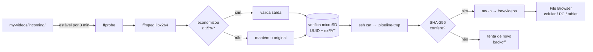

# 🎬 VideoPipeline

**Jogue vídeos numa pasta. O Mac comprime, valida e envia para o seu servidor caseiro. Sem comandos.**

Automação local para macOS que comprime vídeos com **FFmpeg** (sem perder a legibilidade de código na tela) e os publica por **SSH** num servidor Debian antigo (HP Mini) que roda o [File Browser](https://github.com/filebrowser/filebrowser). Toda a conversão acontece no Mac; o servidor só armazena e entrega.

`Python 3` · `FFmpeg` · `SSH` · `SQLite` · `launchd` — zero dependências pip, zero Docker.

---

## Como funciona



1. Você copia um vídeo (pode ser uma pasta inteira) para `my-videos/incoming/`.
2. O **LaunchAgent** do macOS roda a cada 15 min e detecta arquivos novos, esperando terminarem de copiar.
3. O vídeo é analisado, comprimido e **validado** (resolução, duração, codec, áudio).
4. Se a economia for menor que 15%, o original é enviado como está, sem perda geracional.
5. Antes de **cada** envio, o servidor é verificado: `/srv/videos` precisa ser o microSD certo.
6. O arquivo sobe para uma área temporária, é conferido por SHA-256 e só então publicado, de forma atômica.
7. Tudo fica registrado em SQLite e em logs com rotação.

## Recursos

| | |
|---|---|
| 📁 **Preserva pastas** | `incoming/Python/Aula 01.mp4` → `/srv/videos/Python/Aula 01.mp4`, em qualquer profundidade |
| 🔍 **Texto nítido** | libx264 CRF 23, resolução e FPS originais, sem filtros de nitidez |
| 🛡️ **Verifica o microSD** | recusa o envio se `/srv/videos` não for o dispositivo com o UUID esperado, em exFAT, gravável e com espaço |
| ⚛️ **Upload atômico e retomável** | `.part` → SHA-256 → `mv -n`. Arquivo parcial nunca aparece na biblioteca |
| 🚫 **Nunca sobrescreve** | nome existente idêntico = já enviado; diferente = salva como `nome_<hash>.mp4` |
| ♻️ **Recupera de falhas** | queda de energia, rede ou servidor desligado: nada se perde, retoma com backoff (5 min → 6 h) |
| 🔒 **Uma execução por vez** | `flock` do kernel: nunca fica "preso", nunca converte dois vídeos juntos |
| 🧪 **Testado** | 32 testes automatizados + execução real de ponta a ponta |

## Estrutura do projeto

```
.
├── scripts/
│   ├── video_pipeline.py     # o pipeline inteiro (CLI)
│   ├── install.sh            # cria pastas + LaunchAgent (--load ativa)
│   ├── uninstall.sh          # remove só o agente (não apaga vídeos)
│   └── healthcheck.sh        # diagnóstico completo
├── config/config.json        # tudo que é configurável
├── launchd/                  # template do LaunchAgent
├── tests/                    # testes automatizados
├── docs/TESTES.md            # registro dos testes reais e medições
├── CLAUDE.md                 # contexto técnico do projeto
└── my-videos/                # ← seus dados (ignorados pelo git)
    ├── incoming/             #   coloque os vídeos aqui
    ├── processing/           #   conversões em andamento (temporário)
    ├── ready/                #   comprimidos, aguardando envio
    ├── originals/            #   originais arquivados após o envio verificado
    ├── failed/               #   reservado
    ├── logs/                 #   pipeline.log, errors.log
    └── state/                #   pipeline.sqlite3
```

## Começando

### Requisitos

- **Mac** com `python3` (testado com 3.14, só usa a biblioteca padrão), `ffmpeg`/`ffprobe` com libx264 (`brew install ffmpeg`) e `ssh`.
- **Servidor Linux** com SSH e o disco de vídeos montado por UUID em `/srv/videos` (via `/etc/fstab`). Não precisa de rsync, FFmpeg nem nada além do SSH e de utilitários básicos (`findmnt`, `lsblk`, `sha256sum`, `stat`).

### 1. Configure

Edite [`config/config.json`](config/config.json) — a seção `remote`:

```json
"remote": {
  "ssh_user": "rick",
  "local_host": "192.168.15.202",
  "zerotier_host": "10.135.165.226",
  "ssh_key": "~/.ssh/videopipeline_ed25519",
  "remote_root": "/srv/videos",
  "expected_filesystem": "exfat",
  "expected_uuid": "6ACE-6E04"
}
```

Descubra o UUID no servidor com `lsblk -f`. Com `expected_uuid` vazio, **nenhum envio é feito**.

### 2. Chave SSH dedicada

```bash
ssh-keygen -t ed25519 -N "" -f ~/.ssh/videopipeline_ed25519 -C videopipeline
ssh-copy-id -i ~/.ssh/videopipeline_ed25519.pub rick@192.168.15.202   # pede a senha uma vez
```

O pipeline tenta `local_host` primeiro e cai para `zerotier_host` se a rede local não responder.

### 3. Verifique

```bash
python3 scripts/video_pipeline.py status --remote
# Servidor OK (192.168.15.202): /dev/sdb1 UUID=6ACE-6E04 exfat livre=238.7 GB
```

### 4. Ative

```bash
scripts/install.sh --load     # roda ao carregar e a cada 15 min
```

Pronto: copie vídeos para `my-videos/incoming/` e acompanhe com `tail -f my-videos/logs/pipeline.log`.

## Comandos

```bash
python3 scripts/video_pipeline.py status [--remote]   # fila, pendências, economia, erros; --remote testa servidor+microSD
python3 scripts/video_pipeline.py run                 # um ciclo manual completo
python3 scripts/video_pipeline.py dry-run             # mostra o que faria, sem alterar nada
python3 scripts/video_pipeline.py scan                # só detecta arquivos novos
python3 scripts/video_pipeline.py retry               # recoloca falhas na fila e zera o backoff
scripts/healthcheck.sh                                # diagnóstico: ferramentas, agente, chave, servidor, erros
scripts/uninstall.sh                                  # desativa o agente (vídeos e histórico ficam)
```

Exemplo de log:

```
[INFO] Novo arquivo: GraphQL/Aula 05.mp4 (14.0 MB)
[INFO] Input: 14.0 MB | 1920x1080@30.0 | h264/aac | 0.98 Mbps | 120s
[INFO] Profile: compact (crf 23, medium). Encoding started
[INFO] Encoding completed em 12s. Output: 6.4 MB. Savings: 54.3%. Validation passed
[INFO] HP Mini acessível; microSD verificado (UUID 6ACE-6E04)
[INFO] Upload started: GraphQL/Aula 05.mp4
[INFO] Remote checksum verified
[INFO] Published: GraphQL/Aula 05.mp4. Job completed
```

## Configuração

| Chave | Padrão | O que faz |
|---|---|---|
| `pipeline.home` | `my-videos` | onde ficam `incoming/`, `ready/`, `logs/`, `state/`… |
| `pipeline.file_stability_seconds` | `180` | só processa arquivos sem modificação há esse tempo |
| `pipeline.max_encode_attempts` | `3` | falhas de conversão antes de marcar `FAILED` |
| `pipeline.archive_originals_after_upload` | `true` | move o original de `incoming/` para `originals/` (mesma estrutura de pastas) após o envio verificado; `false` o deixa em `incoming/` |
| `pipeline.extensions` | mp4 mov mkv m4v webm | formatos aceitos |
| `encoding.default_profile` | `compact` | `quality` (CRF 18), `balanced` (20), `compact` (23) |
| `encoding.minimum_savings_percent` | `15` | abaixo disso, envia o original sem recodificar |
| `encoding.nice` | `10` | prioridade baixa do ffmpeg para não pesar o Mac |
| `remote.min_free_gb` | `1` | folga mínima de espaço no destino |

### Qual perfil escolher?

Medido num screencast real de programação (VS Code + terminal, 1080p, 2 min):

| Perfil | CRF | Tamanho | Economia | VMAF |
|---|---|---|---|---|
| original | n/a | 14,7 MB | n/a | n/a |
| `quality` | 18 | 10,3 MB | 30% | 96,9 |
| `balanced` | 20 | 8,8 MB | 40% | 96,6 |
| **`compact`** | **23** | **6,7 MB** | **54%** | **96,0** |

Vídeos já muito comprimidos (ex.: 5 Mbps) podem **aumentar** com CRF baixo. Por isso existe a regra dos 15%: se não compensar, o original é enviado intacto. Detalhes em [docs/TESTES.md](docs/TESTES.md).

## Segurança dos dados

- **Originais nunca são apagados nem sobrescritos.** Após o envio verificado (`archive_originals_after_upload`, ligado), são apenas **movidos** de `incoming/` para `originals/`, e só se o arquivo não mudou desde o processamento. Se já existir um com o mesmo nome, ganha o sufixo ` (1)`. O único arquivo removido é o derivado em `ready/`, regenerável.
- **Sem `--delete`**, sem sincronização destrutiva, sem `chown`/`chmod` no cartão exFAT.
- **Nunca usa o disco interno do servidor como alternativa.** Se o microSD não estiver montado, o arquivo fica local e espera.
- Sem senhas em scripts, JSON ou logs: autenticação só por chave SSH dedicada. O SSH nunca é exposto à internet; o acesso remoto é via ZeroTier.
- Nomes são ajustados para exFAT (`" * : < > ? \ |` viram `_`) e normalizados em Unicode.

## Estados de um vídeo

`WAITING_STABLE` → `QUEUED` → `PROCESSING` → `UPLOAD_PENDING` → `UPLOADING` → **`COMPLETED`**
(`FAILED` após falhas permanentes; `SUPERSEDED` se o arquivo mudou antes de processar). Falhas temporárias ficam no mesmo estado com `next_attempt` crescente. Reiniciou no meio? `PROCESSING` volta para a fila e `UPLOADING` para pendente.

## Solução de problemas

| Sintoma | Causa provável | O que fazer |
|---|---|---|
| `status --remote` diz "HP Mini inacessível" | servidor desligado ou chave não autorizada | `scripts/healthcheck.sh`; refaça o `ssh-copy-id` |
| "NÃO é ponto de montagem" | microSD desconectado ou não montado | reconecte/monte no servidor; o envio retoma sozinho |
| "UUID … != esperado" | outro dispositivo em `/srv/videos` | confira `lsblk -f`; **não** altere `expected_uuid` sem certeza |
| Vídeo parado em `WAITING_STABLE` | arquivo ainda sendo modificado | aguarde `file_stability_seconds` |
| Job em `FAILED` | arquivo corrompido ou ffmpeg falhou | veja `my-videos/logs/errors.log`; depois `retry` |
| Nada acontece | agente não carregado ou sessão encerrada | `scripts/healthcheck.sh`; `scripts/install.sh --load` |

## Limitações

- O **LaunchAgent roda na sessão do usuário**: com o Mac desligado ou sem login, nada processa; ao voltar, as pendências continuam.
- Pastas vazias não são criadas no servidor, só as que contêm vídeos.
- Legendas e streams extras não são copiados para o MP4 de saída (o log registra isso). Só o primeiro vídeo e o primeiro áudio.
- O File Browser original está arquivado e não recebe correções de segurança: não o exponha diretamente à internet.

## Testes

```bash
python3 -m unittest discover -s tests -v
```

32 testes (~5 s) com servidor simulado em diretório temporário e vídeos sintéticos gerados pelo ffmpeg. Cobrem arquivo novo/alterado/em transferência, sem áudio, nomes com acentos e espaços, arquivo corrompido, falha do ffmpeg, SSH fora, microSD desmontado, sem espaço, conflito de nomes, hash divergente, recuperação após queda, execuções simultâneas e dry-run.
