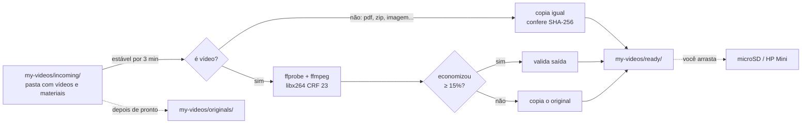

# 🎬 VideoPipeline

**Jogue uma pasta de aula em `incoming/`. O Mac comprime os vídeos, copia o resto igual e deixa tudo pronto em `ready/`. Você só arrasta para o microSD.**

Automação local para macOS que comprime vídeos com **FFmpeg** (sem perder a legibilidade de código na tela) e entrega a pasta pronta em `my-videos/ready/`, com a mesma estrutura de subpastas. O arquivo vai para o servidor Debian (HP Mini, com [File Browser](https://github.com/filebrowser/filebrowser)) **manualmente**: você arrasta `ready/` para o microSD. Toda a conversão acontece no Mac.

> O envio automático por SSH (com verificação de UUID do microSD, SHA-256 e publicação atômica) continua no código, mas desligado. Veja [Modo upload](#modo-upload-opcional).

`Python 3` · `FFmpeg` · `SQLite` · `caffeinate` — zero dependências pip, zero Docker.

---

## Como funciona



1. Você copia uma pasta (ou vários vídeos) para `my-videos/incoming/`.
2. Você dispara **manualmente** (`python3 main.py start`). O pipeline detecta os arquivos, espera os recém-copiados ficarem estáveis e **impede o Mac de suspender** enquanto trabalha.
3. **Vídeos** são analisados, comprimidos e **validados** (resolução, duração, codec, áudio). Se a economia for menor que 15%, o original é copiado como está, sem perda geracional.
4. **Qualquer outro arquivo** (PDF, imagem, zip, planilha...) é copiado igual, conferido por SHA-256, com a data original preservada. Eles são processados **primeiro**; os vídeos ficam por último, para os materiais não esperarem uma conversão longa.
5. O resultado fica em `my-videos/ready/`, **com a mesma estrutura de pastas**, pronto para você arrastar para o microSD.
6. Depois de pronto e validado, cada original é **movido** de `incoming/` para `my-videos/originals/`, e as pastas que ficarem vazias em `incoming/` são removidas. Tudo fica registrado em SQLite e em logs.

## Recursos

| | |
|---|---|
| 📁 **Preserva pastas** | `incoming/Python/Aula 01.mp4` → `ready/Python/Aula 01.mp4`, em qualquer profundidade |
| 📎 **Copia o resto igual** | PDFs, imagens, zips e planilhas vão junto, byte a byte (SHA-256) |
| 🔍 **Texto nítido** | libx264 CRF 23, resolução e FPS originais, sem filtros de nitidez |
| 🚫 **Nunca sobrescreve** | nome já existente em `ready/`: idêntico = reaproveita; diferente = `nome (1).ext` |
| ♻️ **Recupera de falhas** | queda de energia no meio: o job volta para a fila e nada se perde; erros tentam de novo com espera crescente (5 min → 6 h) |
| 🛰️ **Upload SSH opcional** | modo `upload`: verifica UUID/exFAT do microSD, SHA-256 e publica de forma atômica |
| 🔒 **Uma execução por vez** | `flock` do kernel: nunca fica "preso", nunca converte dois vídeos juntos |
| 🌙 **Não deixa o Mac dormir** | enquanto processa, bloqueia a suspensão (`caffeinate`); em segundo plano, continua mesmo fechando o Terminal |
| 🧪 **Testado** | 48 testes automatizados + execução real de ponta a ponta |

## Estrutura do projeto

```
.
├── main.py                 # o pipeline inteiro (um único arquivo Python)
├── README.md
├── CLAUDE.md               # contexto técnico para o Claude Code
├── support/                # tudo o que apoia o main.py
│   ├── config/
│   │   └── config.json     #   configuração (perfil, modo, servidor)
│   ├── scripts/
│   │   └── healthcheck.sh  #   diagnóstico completo
│   └── tests/              #   testes automatizados
└── my-videos/              # ← seus dados (ignorados pelo git)
    ├── incoming/           #   coloque os vídeos/pastas aqui
    ├── processing/         #   conversões e cópias em andamento (temporário)
    ├── ready/              #   ✅ RESULTADO: arraste daqui para o microSD
    ├── originals/          #   originais arquivados depois de prontos
    ├── logs/               #   pipeline.log, errors.log
    └── state/              #   pipeline.sqlite3 (histórico: não apague)
```

## Começando

### Requisitos

- **Mac** com `python3` (testado com 3.14, só usa a biblioteca padrão) e `ffmpeg`/`ffprobe` com libx264 (`brew install ffmpeg`).
- Não precisa de servidor, rede nem SSH no modo padrão.

### Usar

1. Copie uma pasta de aula para `my-videos/incoming/`.
2. Dispare o processamento **em segundo plano**:
   ```bash
   python3 main.py start
   ```
   Ele continua mesmo que você feche o Terminal, e **o Mac não suspende** enquanto houver trabalho (deixe-o na tomada). Acompanhe com `tail -f my-videos/logs/pipeline.log` ou `python3 main.py status`.
3. Quando terminar (`status` mostra "Execução: parada"), pegue o resultado em `my-videos/ready/` e arraste para o microSD.
4. Depois de copiar, pode esvaziar `ready/` à vontade: o histórico evita reprocessar.

Prefere ver o andamento na tela? Use `python3 main.py run` (primeiro plano; `Ctrl+C` interrompe). Se copiar novos arquivos **durante** a execução, ela os espera ficarem estáveis (3 min) e os processa também; ela só termina quando não resta nada.

> **Dica:** numa primeira leva grande, rode `start`, deixe o Mac **na tomada com a tampa aberta** (a tela pode apagar). Fechar a tampa suspende o Mac, a menos que haja um monitor externo (veja Limitações).

## Comandos

```bash
python3 main.py status [--remote]      # fila, economia, erros; --remote testa servidor+microSD (modo upload)
python3 main.py start                  # processa tudo em SEGUNDO PLANO (sobrevive ao Terminal)
python3 main.py run                    # o mesmo, em primeiro plano (Ctrl+C interrompe)
python3 main.py stop                   # encerra a execução em andamento (e o ffmpeg)
python3 main.py dry-run                # mostra o que faria, sem alterar nada
python3 main.py scan                   # só detecta arquivos novos
python3 main.py retry                  # recoloca falhas na fila e zera o backoff
support/scripts/healthcheck.sh         # diagnóstico: ferramentas, estado, erros
```

Exemplo de log:

```
[INFO] Novo arquivo: GraphQL/Aula 05.mp4 (14.0 MB)
[INFO] enfileirado estável: GraphQL/Aula 05.mp4
[INFO] Input: 14.0 MB | 1920x1080@30.0 | h264/aac | 0.98 Mbps | 120s
[INFO] Profile: compact (crf 23, medium). Encoding started
[INFO] Encoding completed em 12s. Output: 6.4 MB. Savings: 54.3%. Validation passed
[INFO] Pronto em ready/GraphQL/Aula 05.mp4 [encoded]. Job completed
[INFO] Original arquivado: originals/GraphQL/Aula 05.mp4
```

## Configuração

| Chave | Padrão | O que faz |
|---|---|---|
| `pipeline.home` | `my-videos` | onde ficam `incoming/`, `ready/`, `logs/`, `state/`… |
| `pipeline.file_stability_seconds` | `180` | só processa arquivos sem modificação há esse tempo |
| `pipeline.max_encode_attempts` | `3` | falhas de conversão antes de marcar `FAILED` |
| `pipeline.mode` | `local` | `local`: tudo termina em `ready/` (envio manual). `upload`: envia ao HP Mini por SSH |
| `pipeline.copy_non_video` | `true` | copia arquivos que não são vídeo para `ready/` (só no modo `local`) |
| `pipeline.archive_originals_after_upload` | `true` | move cada original de `incoming/` para `originals/` (mesma estrutura) depois de pronto; `false` o deixa em `incoming/` |
| `pipeline.extensions` | mp4 mov mkv m4v webm | extensões tratadas como **vídeo** (as demais são só copiadas) |
| `pipeline.prevent_sleep` | `true` | impede o Mac de suspender enquanto há trabalho (`caffeinate`) |
| `pipeline.wait_for_stable` | `true` | a execução espera arquivos recém-copiados ficarem estáveis e só termina sem pendências |
| `pipeline.poll_seconds` | `15` | de quanto em quanto tempo checa se os arquivos já estabilizaram |
| `encoding.default_profile` | `compact` | `quality` (CRF 18), `balanced` (20), `compact` (23) |
| `encoding.minimum_savings_percent` | `15` | abaixo disso, mantém o original (copia sem recodificar) |
| `encoding.nice` | `10` | prioridade baixa do ffmpeg para não pesar o Mac |
| `remote.*` | n/a | só no modo `upload` (host, usuário, chave, UUID do microSD...) |

### Qual perfil escolher?

Medido num screencast real de programação (VS Code + terminal, 1080p, 2 min):

| Perfil | CRF | Tamanho | Economia | VMAF |
|---|---|---|---|---|
| original | n/a | 14,7 MB | n/a | n/a |
| `quality` | 18 | 10,3 MB | 30% | 96,9 |
| `balanced` | 20 | 8,8 MB | 40% | 96,6 |
| **`compact`** | **23** | **6,7 MB** | **54%** | **96,0** |

Vídeos já muito comprimidos (ex.: 5 Mbps) podem **aumentar** com CRF baixo. Por isso existe a regra dos 15%: se não compensar, o original é mantido intacto. Registro das medições abaixo.

## Segurança dos dados

- **Originais nunca são apagados nem sobrescritos.** Depois de prontos, são apenas **movidos** de `incoming/` para `originals/`, e só se o arquivo não mudou desde o processamento. Nome repetido ganha o sufixo ` (1)`.
- **`ready/` nunca sobrescreve:** arquivo idêntico é reaproveitado, diferente ganha ` (1)`.
- **Cópias verificadas:** arquivos não-vídeo só aparecem em `ready/` depois de conferidos por SHA-256 (cópia via `processing/`, depois renomeada de forma atômica).
- **Nomes compatíveis com exFAT:** `" * : < > ? \ |` viram `_` e o texto é normalizado em Unicode, para você arrastar para o microSD sem o Finder reclamar.
- Arquivos ocultos (`.DS_Store`, `._algo`, pastas que começam com `.`) e temporários (`.part`, `.crdownload`, `.tmp`) são ignorados.
- No modo `upload`: sem senhas em scripts, sem `--delete`, nunca usa o disco interno do servidor como alternativa.

## Modo upload (opcional)

Desligado por padrão. Para o pipeline enviar sozinho ao servidor, defina `"mode": "upload"` no config, preencha a seção `remote` e crie a chave SSH:

```bash
ssh-keygen -t ed25519 -N "" -f ~/.ssh/videopipeline_ed25519 -C videopipeline
ssh-copy-id -i ~/.ssh/videopipeline_ed25519.pub rick@192.168.15.202
python3 main.py status --remote   # confere servidor + microSD
```

Nesse modo, antes de **cada** envio o servidor precisa passar: SSH ok, `/srv/videos` é ponto de montagem do UUID esperado, exFAT, gravável, com espaço. O arquivo sobe para `.pipeline-tmp/`, é conferido por SHA-256 e publicado com `mv -n` (nunca sobrescreve; conflito vira `nome_<hash>.ext`). Só vídeos são enviados nesse modo.

## Estados de um vídeo

`WAITING_STABLE` → `QUEUED` → `PROCESSING` → **`COMPLETED`** (no modo `upload`: … → `UPLOAD_PENDING` → `UPLOADING` → `COMPLETED`)
(`FAILED` após falhas permanentes; `SUPERSEDED` se o arquivo mudou antes de processar). Falhas temporárias ficam no mesmo estado com `next_attempt` crescente. Reiniciou no meio? `PROCESSING` volta para a fila (e o temporário é apagado).

## Solução de problemas

| Sintoma | Causa provável | O que fazer |
|---|---|---|
| Arquivo não aparece em `ready/` | ainda na fila (vídeos longos demoram), ou ainda "estável" | `status`; veja `my-videos/logs/pipeline.log` |
| *(modo upload)* "HP Mini inacessível" | servidor desligado ou chave não autorizada | `support/scripts/healthcheck.sh`; refaça o `ssh-copy-id` |
| *(modo upload)* "NÃO é ponto de montagem" / "UUID … != esperado" | microSD ausente ou outro dispositivo | reconecte/monte no servidor; **não** altere `expected_uuid` sem certeza |
| Vídeo parado em `WAITING_STABLE` | arquivo ainda sendo modificado | aguarde `file_stability_seconds` |
| Job em `FAILED` | arquivo corrompido ou ffmpeg falhou | veja `my-videos/logs/errors.log`; depois `retry` |
| Nada acontece | o processamento é manual | rode `python3 main.py start`; confira com `status` |
| Parou no meio | você deu `stop`, o Mac desligou ou reiniciou | rode `start` de novo: o vídeo interrompido volta para a fila e recomeça |

## Limitações

- **Não há varredura automática:** nada é processado até você rodar `start` ou `run`.
- **Suspensão:** o `caffeinate` impede a suspensão por ociosidade e, **na tomada**, a suspensão do sistema. **Fechar a tampa** do MacBook suspende mesmo assim, a não ser que ele esteja na tomada com um **monitor externo** ligado. Desligar, reiniciar ou fazer logout interrompe o processamento; ao rodar `start` de novo, ele retoma.
- Pastas vazias não são recriadas em `ready/`, só as que contêm arquivos.
- Um processamento por vez: vídeos longos ocupam a fila por um tempo, mas os arquivos que não são vídeo sempre passam na frente.
- Legendas e streams extras não são copiados para o MP4 de saída (o log registra isso). Só o primeiro vídeo e o primeiro áudio.
- O File Browser original está arquivado e não recebe correções de segurança: não o exponha diretamente à internet.

## Testes

```bash
python3 -m unittest discover -s support/tests -v
```

48 testes (~10 s) com servidor simulado em diretório temporário e vídeos sintéticos gerados pelo ffmpeg. Cobrem arquivo novo/alterado/em transferência, sem áudio, nomes com acentos e espaços, arquivo corrompido, falha do ffmpeg, SSH fora, microSD desmontado, sem espaço, conflito de nomes, hash divergente, recuperação após queda, execuções simultâneas e dry-run.

## Registro de testes reais (2026-10-13)

- **Screencast de programação** (VS Code + terminal, 1080p, trecho de 2 min, H.264 0,85 Mbps): tabela de perfis acima. Texto de código, terminal e árvore de arquivos legível no CRF 23 (conferido visualmente); perfil `compact` aprovado.
- **Vídeo de pessoa falando** (1080p, H.264 5,2 Mbps): CRF 18 e 20 ficaram **maiores** que o original (+32% e +7%); só o CRF 23 economizou (−25%). É o motivo da regra dos 15%.
- **Pipeline de ponta a ponta** (modo `upload`, antes de o modo `local` virar o padrão): clipe comprimido (14,0 → 6,4 MB), verificado e publicado no HP Mini; SHA-256 remoto igual ao local. Neste ensaio descobrimos que o servidor não tem `rsync`, por isso o envio usa `ssh cat` retomável.
