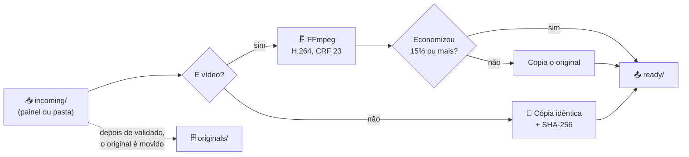

<h1>VideoPipeline 🎬</h1>

Este é um projeto de automação local para Mac que comprime vídeos de aula: o usuário arrasta vídeos e pastas inteiras para uma página no navegador, o Mac comprime os vídeos com FFmpeg, copia os demais arquivos iguais e deixa tudo pronto em `my-videos/ready/`, com a mesma estrutura de pastas.


<h2>⚙️ Funcionalidades do Sistema </h2>

<h4>🖱️ Painel de tela única: soltar aulas, iniciar, parar e acompanhar tudo ao vivo. </h4>
<h4>🗜️ Compressão dos vídeos com FFmpeg (H.264, CRF 23), sem mudar resolução nem FPS. </h4>
<h4>📎 Cópia dos demais arquivos (PDF, imagens, zip...) idênticos, conferidos por SHA-256 e com as datas preservadas. </h4>
<h4>🛡️ Nenhum original é apagado: ele é movido de incoming/ para originals/ só depois de validado. </h4>
<h4>🎛️ Ajustes de compressão pelo painel, com o comando do FFmpeg equivalente. </h4>

<h2>🎬 Começando...</h2>

Essas instruções permitirão que você consiga realizar uma cópia do projeto em operação em seu Mac para fins de uso e desenvolvimento.

<h3>🕹️ Hardwares Utilizados</h3>

 * MacBook com Apple M1 (onde acontece toda a conversão)

<h3>🧑🏻‍💻 Softwares Utilizados</h3>

 * [🔗 Python 3](https://www.python.org/) (somente a biblioteca padrão)
 * [🔗 FFmpeg](https://ffmpeg.org/)
 * [🔗 Homebrew](https://brew.sh/) (para instalar o FFmpeg)

<h2>🚀 Instalação</h2>

<ul>
  <li>
    <h3 id="secao-diagrama-blocos">Diagrama De Blocos</h3>



  </li>

  <li>
    <h3 id="secao-estrutura-pastas">Estrutura De Pastas</h3>

```
.
├── main.py                 # pipeline + CLI + servidor do painel
├── config/config.json      # configuração (perfil de compressão e comportamento)
├── dashboard/              # painel: index.html, css/ e js/ (módulos, sem build)
├── scripts/healthcheck.sh  # diagnóstico completo
├── tests/                  # testes automatizados
├── docs/                   # guia completo e imagem do README
└── my-videos/              # seus dados (ignorados pelo git)
    ├── incoming/           #   coloque os vídeos/pastas aqui (ou arraste no painel)
    ├── processing/         #   conversões em andamento (temporário)
    ├── ready/              #   RESULTADO: vídeos comprimidos e materiais copiados
    ├── originals/          #   originais arquivados depois de prontos
    ├── logs/               #   pipeline.log, errors.log
    └── state/              #   histórico (não apague) e progresso ao vivo
```

  </li>
</ul>

<h2 id="secao-testes">⚙️ Executando os testes</h2>

1. Instalar o FFmpeg e o ffprobe:
    ```bash
    brew install ffmpeg
    ```

2. Baixar o projeto:
    ```bash
    git clone https://github.com/FernandoHN99/automation-videos-macos.git
    cd automation-videos-macos
    ```

3. Conferir o ambiente (ferramentas, estado do pipeline e últimos erros):
    ```bash
    bash scripts/healthcheck.sh
    ```

4. Rodar os testes automatizados:
    ```bash
    python3 -m unittest discover -s tests
    ```

Os testes usam vídeos sintéticos minúsculos criados pelo próprio FFmpeg em pastas temporárias, então nada de `my-videos/` é tocado. Eles cobrem o fluxo completo (compressão, validação e arquivamento), a entrega em `ready/`, a recuperação de falhas, o painel (dados, envio de arquivos, token e arquivos estáticos) e os ajustes de compressão.

> **Observação:** Se algum teste de vídeo falhar, verifique se `ffmpeg` e `ffprobe` estão no PATH (`brew install ffmpeg`).

<h2>📦 Implementação</h2>

1. Abrir o painel (abre http://127.0.0.1:8765 no navegador):
    ```bash
    python3 main.py app
    ```

2. Soltar as aulas (arquivos ou pastas inteiras) em qualquer ponto da janela, ou usar **Escolher arquivos** / **Escolher pasta**.

3. Clicar em **Enviar e iniciar** e acompanhar a fila, a linha do tempo e a economia de espaço.

4. Quando terminar, o resultado está em `my-videos/ready/`.

5. Conferir a qualidade dos vídeos e, só então, apagar `my-videos/originals/` manualmente.

Também dá para trabalhar só pelo terminal:

```bash
python3 main.py start     # processa em segundo plano o que está em incoming/
python3 main.py status    # mostra o estado e o PID da execução
python3 main.py stop      # encerra a execução (e o FFmpeg)
```

> **Importante:** O pipeline nunca apaga nem sobrescreve nada: o original é movido para `originals/` e um arquivo de destino que já existe nunca é substituído. Enquanto há trabalho o Mac é mantido acordado (`caffeinate`), mas fechar a tampa do MacBook sem monitor externo suspende mesmo assim.

> **Configuração:** o perfil padrão (`compact`, CRF 23) e o comportamento do pipeline ficam em `config/config.json`. Configuração, qualidade e solução de problemas estão no [🔗 guia completo](docs/GUIA.md).

<h2>🎁 Expressões de gratidão</h2>

Agradecimentos aos projetos de código aberto [🔗 FFmpeg](https://ffmpeg.org/) e [🔗 Python](https://www.python.org/), que fazem todo o trabalho pesado por baixo do painel.

---
