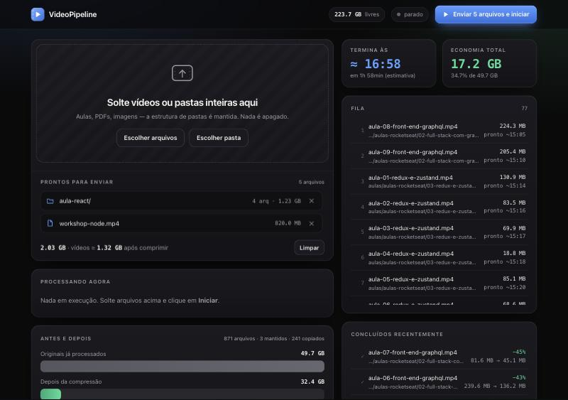

# 🎬 VideoPipeline

Arraste vídeos e pastas de aula para uma página no navegador. O Mac comprime os vídeos (FFmpeg), copia o resto igual e deixa tudo pronto em `my-videos/ready/`, com a mesma estrutura de pastas. Depois é só arrastar `ready/` para o microSD. Tudo roda local, só com Python 3 e FFmpeg (`brew install ffmpeg`).



## Rodar

Abrir a tela (arraste os arquivos, clique em **Enviar e iniciar** e acompanhe):

```bash
python3 main.py app
```

Ou, para processar em segundo plano o que já está em `my-videos/incoming/`:

```bash
python3 main.py start
```

Mais detalhes (configuração, qualidade, modo upload, problemas): [docs/GUIA.md](docs/GUIA.md).
