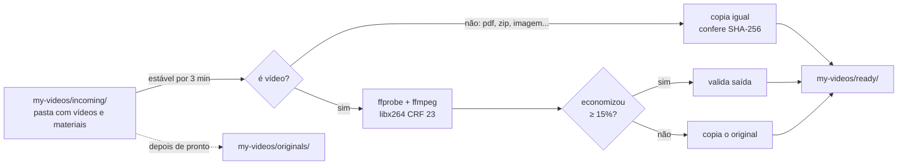

# 🎬 VideoPipeline — guia completo

> Resumo e comandos rápidos: [README](../README.md).

**Jogue uma pasta de aula em `incoming/`. O Mac comprime os vídeos, copia o resto igual e deixa tudo pronto em `ready/`.**

Automação local para macOS que comprime vídeos com **FFmpeg** (sem perder a legibilidade de código na tela) e entrega a pasta pronta em `my-videos/ready/`, com a mesma estrutura de subpastas. Toda a conversão acontece no Mac.

`Python 3` · `FFmpeg` · `SQLite` · `caffeinate` — zero dependências pip, zero Docker.

---

## Como funciona



1. Você copia uma pasta (ou vários vídeos) para `my-videos/incoming/`.
2. Você dispara **manualmente** (`python3 main.py start`). O pipeline detecta os arquivos, espera os recém-copiados ficarem estáveis e **impede o Mac de suspender** enquanto trabalha.
3. **Vídeos** são analisados, comprimidos e **validados** (resolução, duração, codec, áudio). Se a economia for menor que 15%, o original é copiado como está, sem perda geracional.
4. **Qualquer outro arquivo** (PDF, imagem, zip, planilha...) é copiado igual, conferido por SHA-256, com a data original preservada. Eles são processados **primeiro**; os vídeos ficam por último, para os materiais não esperarem uma conversão longa.
5. O resultado fica em `my-videos/ready/`, **com a mesma estrutura de pastas**.
6. Depois de pronto e validado, cada original é **movido** de `incoming/` para `my-videos/originals/`, e a pasta que ficar vazia em `incoming/` é removida **na hora em que o último arquivo dela é arquivado** (subindo até a raiz). Tudo fica registrado em SQLite e em logs.

## Recursos

| | |
|---|---|
| 📁 **Preserva pastas** | `incoming/Python/Aula 01.mp4` → `ready/Python/Aula 01.mp4`, em qualquer profundidade |
| 📎 **Copia o resto igual** | PDFs, imagens, zips e planilhas vão junto, byte a byte (SHA-256) |
| 🔍 **Texto nítido** | libx264 CRF 23, resolução e FPS originais, sem filtros de nitidez |
| 🚫 **Nunca sobrescreve** | nome já existente em `ready/`: idêntico = reaproveita; diferente = `nome (1).ext` |
| ♻️ **Recupera de falhas** | queda de energia no meio: o job volta para a fila e nada se perde; erros tentam de novo com espera crescente (5 min → 6 h) |
| 🔒 **Uma execução por vez** | `flock` do kernel: nunca fica "preso", nunca converte dois vídeos juntos |
| 🌙 **Não deixa o Mac dormir** | enquanto processa, bloqueia a suspensão (`caffeinate`); em segundo plano, continua mesmo fechando o Terminal |
| 🧪 **Testado** | 65 testes automatizados + execução real de ponta a ponta |

## Estrutura do projeto

```
.
├── main.py                 # o pipeline + CLI + servidor do painel (um único arquivo Python)
├── config/config.json      # configuração (perfil de compressão e comportamento)
├── dashboard/              # a interface web: index.html (casca), css/ e js/ (módulos, sem build)
├── scripts/healthcheck.sh  # diagnóstico completo
├── tests/                  # testes automatizados
├── docs/                   # este guia e a imagem do README
├── README.md               # resumo e comandos
├── CLAUDE.md               # contexto técnico para o Claude Code
└── my-videos/              # ← seus dados (ignorados pelo git)
    ├── incoming/           #   coloque os vídeos/pastas aqui (ou arraste no painel)
    ├── processing/         #   conversões e cópias em andamento (temporário)
    ├── ready/              #   ✅ RESULTADO: vídeos comprimidos e materiais copiados
    ├── originals/          #   originais arquivados depois de prontos
    ├── logs/               #   pipeline.log, errors.log
    └── state/              #   pipeline.sqlite3 (histórico: não apague) e progress.json
```

## Começando

### Requisitos

- **Mac** com `python3` (testado com 3.14, só usa a biblioteca padrão) e `ffmpeg`/`ffprobe` com libx264 (`brew install ffmpeg`).
- Não precisa de servidor nem de rede: tudo roda no Mac.

### Usar

1. Copie uma pasta de aula para `my-videos/incoming/`.
2. Dispare o processamento **em segundo plano**:
   ```bash
   python3 main.py start
   ```
   Ele continua mesmo que você feche o Terminal, e **o Mac não suspende** enquanto houver trabalho (deixe-o na tomada). Acompanhe com `tail -f my-videos/logs/pipeline.log` ou `python3 main.py status`.
3. Quando terminar (`status` mostra "Execução: parada"), o resultado está em `my-videos/ready/`.
4. Depois de levar o resultado para onde precisar, pode esvaziar `ready/` à vontade: o histórico evita reprocessar.

Prefere ver o andamento na tela? Use `python3 main.py run` (primeiro plano; `Ctrl+C` interrompe). Se copiar novos arquivos **durante** a execução, ela os espera ficarem estáveis (3 min) e os processa também; ela só termina quando não resta nada.

> **Dica:** numa primeira leva grande, rode `start`, deixe o Mac **na tomada com a tampa aberta** (a tela pode apagar). Fechar a tampa suspende o Mac, a menos que haja um monitor externo (veja Limitações).

## Comandos

```bash
python3 main.py app [--port 8765]       # abre o painel no navegador (enviar, iniciar, parar, acompanhar)
python3 main.py dashboard [--port 8765] # igual, sem abrir o navegador
python3 main.py status                 # fila, economia e erros
python3 main.py start                  # processa tudo em SEGUNDO PLANO (sobrevive ao Terminal)
python3 main.py run                    # o mesmo, em primeiro plano (Ctrl+C interrompe)
python3 main.py stop                   # encerra a execução em andamento (e o ffmpeg)
python3 main.py dry-run                # mostra o que faria, sem alterar nada
python3 main.py scan                   # só detecta arquivos novos
python3 main.py retry                  # recoloca falhas na fila e zera o backoff
scripts/healthcheck.sh         # diagnóstico: ferramentas, estado, erros
```

Exemplo de log:

```
[INFO] Novo arquivo: GraphQL/Aula 05.mp4 (14.0 MB)
[INFO] enfileirado estável: GraphQL/Aula 05.mp4
[INFO] Input: 14.0 MB | 1920x1080@30.0 | h264/aac | 0.98 Mbps | 120s
[INFO] Profile: compact (crf 23, medium). Encoding started
[INFO] Encoding completed em 12s. Output: 6.4 MB. Savings: 54.3%. Validation passed
[INFO] Pronto em ready/GraphQL/Aula 05.mp4 [encoded]. Job completed
[INFO] Original arquivado: originals/GraphQL/Aula 05.mp4
```

## Painel (interface web)

`python3 main.py app` abre http://127.0.0.1:8765 no navegador. É um console de **tela única**: tudo o que importa fica visível ao mesmo tempo (no celular ou em janela estreita os painéis empilham).

- **Herói (o painel grande):** muda conforme o que há para fazer. Parado, mostra uma carta de ajuste de vídeo (as barras de teste) com a claquete **Solte as aulas aqui**: arraste vídeos e pastas inteiras para qualquer ponto da janela, ou use *Escolher arquivos / Escolher pasta*; a estrutura é mantida e arquivos ocultos como `.DS_Store` são ignorados. Com arquivos escolhidos, lista os grupos, a economia prevista e **Enviar e iniciar** (manda tudo para `my-videos/incoming/` sem sobrescrever, preservando a data original, e começa). Com a fila esperando, oferece **Iniciar fila**. Processando, a carta encolhe para uma fita e entra a leitura ao vivo: o vídeo atual com o percentual grande, o tempo que falta, a velocidade (×o tempo real), o tamanho gerado até agora, a hora em que a fila termina e um traço da velocidade.
- **Linha do tempo:** a sequência da fila sobre uma régua de horário. Cada arquivo é um trecho com largura proporcional ao tempo de compressão (ciano = pronto nesta sessão, amarelo = em andamento, azul = na fila; materiais são uma faixa baixa), com a agulha de "agora". Passe o mouse num trecho para ver o nome.
- **Economia total:** quanto foi economizado desde o início, antes e depois (a parte hachurada é o que foi economizado) e a previsão para a fila. **Disco** mostra o espaço livre.
- **Fila / Concluídos:** a fila na ordem real, com o horário previsto de cada item (abas *Na fila*, *Aguardando* e *Falhas*), e os últimos concluídos, cada um com uma barra do tamanho final.
- **Como comprime:** o processo atual em português e o botão **Ajustar**, que abre a gaveta de ajustes (veja abaixo).

Botões só quando fazem sentido: **Parar** só aparece rodando (com confirmação; o vídeo em andamento volta à fila no próximo início). Enquanto roda, o envio de arquivos e os ajustes ficam bloqueados (o servidor também recusa). Falhas e pouco disco (abaixo de 10 GB) aparecem como avisos na barra superior.

### Compressão: o que acontece com cada vídeo (e como ajustar)

O painel **Como comprime** descreve, em português, exatamente o processo atual (o padrão do `config/config.json`, que nunca é alterado):

- **Vídeo** recodificado em H.264 (libx264), CRF 23, preset medium, pixels yuv420p; resolução e FPS **mantidos**.
- **Áudio** copiado sem perda se já for AAC; senão convertido para AAC 128k.
- **Faixas:** só o 1º vídeo e o 1º áudio são mantidos; **legendas, áudios extras, anexos e dados são descartados**.
- **Metadados e capítulos** copiados; MP4 com faststart.
- Se a economia ficar **abaixo de 15%**, o original é copiado sem recomprimir.
- A saída só é aceita se resolução, duração (±1%), codec e presença de áudio baterem.

Antes de iniciar (com o processamento parado) dá para **ajustar**: codec (H.264, HEVC ou os encoders de hardware VideoToolbox), CRF/qualidade, preset, tune, perfil, resolução e FPS máximos (só reduzem), áudio (automático, sempre AAC ou remover) e taxa, economia mínima, threads, prioridade (`nice`), faststart e cópia de metadados. Há atalhos (os perfis do config) e **Restaurar padrão**. O painel mostra o comando do ffmpeg equivalente (ao vivo, com botão copiar) e avisos (ex.: HEVC pode não tocar em players antigos; hardware gera arquivos maiores).

Os ajustes ficam em `my-videos/state/encoding.json` (fora do git) e valem para os próximos vídeos; salvar valores iguais ao padrão apaga o arquivo. Cada job guarda os ajustes usados (coluna `settings`) e a estimativa de tempo/redução usa só o histórico feito com os mesmos ajustes (sem histórico, mostra "estimativa"). Só valores de listas/faixas conhecidas chegam ao ffmpeg (nada de texto livre).

Cores (tiradas das barras de teste de vídeo, cada uma com um papel fixo): amarelo = processando e ação principal, ciano = economia e pronto, azul = na fila, vermelho = falha ou parar, magenta = ajustes personalizados, cinza = parado.

Segurança: o servidor escuta **só em 127.0.0.1**; as ações de escrita exigem um token gerado a cada abertura do painel e o cabeçalho `Host` é verificado (protege contra outras páginas do navegador e DNS rebinding). Caminhos com `..`, absolutos ou ocultos são recusados; nada é sobrescrito nem apagado. O tempo restante vem do ritmo dos vídeos já concluídos; "≈" indica que parte da fila foi estimada por tamanho. O progresso ao vivo vem de `my-videos/state/progress.json`, escrito pelo ffmpeg (`-progress`).

## Configuração

| Chave | Padrão | O que faz |
|---|---|---|
| `pipeline.home` | `my-videos` | onde ficam `incoming/`, `ready/`, `logs/`, `state/`… |
| `pipeline.file_stability_seconds` | `180` | só processa arquivos sem modificação há esse tempo |
| `pipeline.max_encode_attempts` | `3` | falhas de conversão antes de marcar `FAILED` |
| `pipeline.copy_non_video` | `true` | copia arquivos que não são vídeo para `ready/` |
| `pipeline.archive_originals` | `true` | move cada original de `incoming/` para `originals/` (mesma estrutura) depois de pronto; `false` o deixa em `incoming/` |
| `pipeline.extensions` | mp4 mov mkv m4v webm | extensões tratadas como **vídeo** (as demais são só copiadas) |
| `pipeline.prevent_sleep` | `true` | impede o Mac de suspender enquanto há trabalho (`caffeinate`) |
| `pipeline.wait_for_stable` | `true` | a execução espera arquivos recém-copiados ficarem estáveis e só termina sem pendências |
| `pipeline.poll_seconds` | `15` | de quanto em quanto tempo checa se os arquivos já estabilizaram |
| `encoding.default_profile` | `compact` | `quality` (CRF 18), `balanced` (20), `compact` (23) |
| `encoding.minimum_savings_percent` | `15` | abaixo disso, mantém o original (copia sem recodificar) |
| `encoding.nice` | `10` | prioridade baixa do ffmpeg para não pesar o Mac |

### Qual perfil escolher?

Medido num screencast real de programação (VS Code + terminal, 1080p, 2 min):

| Perfil | CRF | Tamanho | Economia | VMAF |
|---|---|---|---|---|
| original | n/a | 14,7 MB | n/a | n/a |
| `quality` | 18 | 10,3 MB | 30% | 96,9 |
| `balanced` | 20 | 8,8 MB | 40% | 96,6 |
| **`compact`** | **23** | **6,7 MB** | **54%** | **96,0** |

Vídeos já muito comprimidos (ex.: 5 Mbps) podem **aumentar** com CRF baixo. Por isso existe a regra dos 15%: se não compensar, o original é mantido intacto. Registro das medições abaixo.

## Segurança dos dados

- **Originais nunca são apagados nem sobrescritos.** Depois de prontos, são apenas **movidos** de `incoming/` para `originals/`, e só se o arquivo não mudou desde o processamento. Nome repetido ganha o sufixo ` (1)`.
- **`ready/` nunca sobrescreve:** arquivo idêntico é reaproveitado, diferente ganha ` (1)`.
- **Cópias verificadas:** arquivos não-vídeo só aparecem em `ready/` depois de conferidos por SHA-256 (cópia via `processing/`, depois renomeada de forma atômica).
- **Nomes portáveis:** `" * : < > ? \ |` viram `_` e o texto é normalizado em Unicode, para a pasta `ready/` poder ser copiada para qualquer sistema (Windows, Linux, discos exFAT) sem reclamação.
- Arquivos ocultos (`.DS_Store`, `._algo`, pastas que começam com `.`) e temporários (`.part`, `.crdownload`, `.tmp`) são ignorados.
## Estados de um vídeo

`WAITING_STABLE` → `QUEUED` → `PROCESSING` → **`COMPLETED`**
(`FAILED` após falhas permanentes; `SUPERSEDED` se o arquivo mudou antes de processar). Falhas temporárias ficam no mesmo estado com `next_attempt` crescente. Reiniciou no meio? `PROCESSING` volta para a fila (e o temporário é apagado).

## Solução de problemas

| Sintoma | Causa provável | O que fazer |
|---|---|---|
| Arquivo não aparece em `ready/` | ainda na fila (vídeos longos demoram), ou ainda "estável" | `status`; veja `my-videos/logs/pipeline.log` |
| Vídeo parado em `WAITING_STABLE` | arquivo ainda sendo modificado | aguarde `file_stability_seconds` |
| Job em `FAILED` | arquivo corrompido ou ffmpeg falhou | veja `my-videos/logs/errors.log`; depois `retry` |
| Nada acontece | o processamento é manual | rode `python3 main.py start`; confira com `status` |
| Parou no meio | você deu `stop`, o Mac desligou ou reiniciou | rode `start` de novo: o vídeo interrompido volta para a fila e recomeça |

## Limitações

- **Não há varredura automática:** nada é processado até você rodar `start` ou `run`.
- **Suspensão:** o `caffeinate` impede a suspensão por ociosidade e, **na tomada**, a suspensão do sistema. **Fechar a tampa** do MacBook suspende mesmo assim, a não ser que ele esteja na tomada com um **monitor externo** ligado. Desligar, reiniciar ou fazer logout interrompe o processamento; ao rodar `start` de novo, ele retoma.
- Pastas vazias não são recriadas em `ready/`, só as que contêm arquivos.
- Um processamento por vez: vídeos longos ocupam a fila por um tempo, mas os arquivos que não são vídeo sempre passam na frente.
- Legendas e streams extras não são copiados para o MP4 de saída (o log registra isso). Só o primeiro vídeo e o primeiro áudio.

## Testes

```bash
python3 -m unittest discover -s tests -v
```

65 testes (~10 s) em diretórios temporários, com vídeos sintéticos gerados pelo ffmpeg. Cobrem arquivo novo/alterado/em transferência, sem áudio, nomes com acentos e espaços, arquivo corrompido, falha do ffmpeg, falha ao entregar em `ready/` (com espera crescente), conflito de nomes, recuperação após queda, execuções simultâneas, dry-run, o painel (dados, envio, token e arquivos estáticos), os ajustes de compressão e a atualização de bancos de versões anteriores.

## Registro de testes reais (2026-10-13)

- **Screencast de programação** (VS Code + terminal, 1080p, trecho de 2 min, H.264 0,85 Mbps): tabela de perfis acima. Texto de código, terminal e árvore de arquivos legível no CRF 23 (conferido visualmente); perfil `compact` aprovado.
- **Vídeo de pessoa falando** (1080p, H.264 5,2 Mbps): CRF 18 e 20 ficaram **maiores** que o original (+32% e +7%); só o CRF 23 economizou (−25%). É o motivo da regra dos 15%.
- **Aula real de ponta a ponta:** vídeo VP9 1080p de 2h11 (1,2 GB) virou H.264 de 828 MB (−30,7%) em 27 min, junto com 236 materiais copiados idênticos (SHA-256 igual, datas preservadas).
